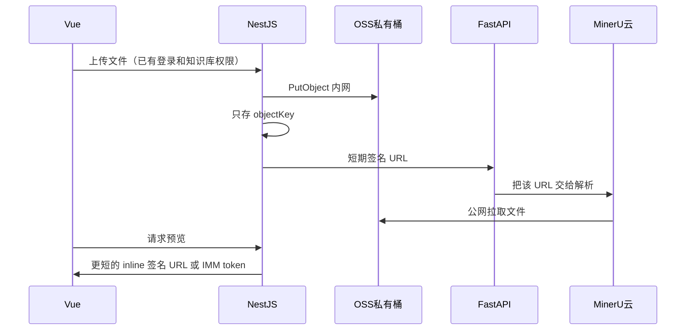

# RAG企业知识库问答系统

## 本机开发（热更新）

一条命令拉起 **postgres + Milvus**，并在本机启动三个热更新进程（不走容器里的 web / Nest / RAG）：

```powershell
.\dev.ps1
```

```bash
chmod +x dev.sh
./dev.sh
```

| 进程 | 命令 | 地址 |
|------|------|------|
| web | `pnpm run dev` | http://localhost:5173 |
| server | `pnpm run start:dev` | http://localhost:3000 |
| agent-server | `uv run rag-server` | http://localhost:8001/docs |
| postgres | `docker compose up -d postgres` | 127.0.0.1:5432 |
| Milvus | `docker compose -f docker-compose.milvus.yml up -d` | localhost:19530 |

Windows 会打开三个终端标签。关掉对应终端即停该进程。停数据库：

```bash
docker compose stop postgres
docker compose -f docker-compose.milvus.yml stop
```

等价的手工命令：

- 前端：`cd web && pnpm install && pnpm dev`
- 业务后端：`cd server && pnpm install && pnpm start:dev`（依赖 postgres）
- RAG：`cd agent-server && uv sync && uv run rag-server`

## 一键启动

启动 **postgres + agent-server + server + web**：

```powershell
# Windows（PowerShell）
.\start.ps1
```

```bash
# macOS / Linux
chmod +x start.sh
./start.sh
```

或直接：

```bash
docker compose up -d --build
```

| 服务 | 地址 |
|------|------|
| Web | http://localhost:8080 |
| Nest API | http://localhost:3000 |
| RAG /docs | http://localhost:8001/docs |
| PostgreSQL | localhost:5432 |

停止：

```bash
docker compose down
```

根目录 `.env` 由 `.env.example` 复制而来；`DASHSCOPE_API_KEY`、`JWT_SECRET` 按需填写。

## 分步启动

```bash
# 只起数据库（本机跑 Nest 时）
docker compose up -d postgres

# 可选：Milvus 向量库（与主栈网络独立）
docker compose -f docker-compose.milvus.yml up -d
```


## 核心数据流转 UML时序图
文件位置：`C:\Users\wuzhenhua\.cursor\plans`

## 私有 OSS + 短期签名 URL

企业里给知识库原文用的就是这套，不把桶设成公共读，也不在数据库里存永久链接。

当前链路是：浏览器把文件交给 Nest，整份内容（文本原文或二进制 base64）写进 [`documents.content`](server/prisma/schema.prisma)，入库时 [`ingest.queue.ts`](server/src/modules/rag/document/ingest.queue.ts) 再把字节重组成文件 POST 给 Python。Python 再落临时文件交给 MinerU（[`rag.py`](agent-server/src/rag_server/services/rag.py) 的 `_load_file_to_markdown`）。换成 OSS 后，库里只留对象键，MinerU 和预览都用临时签名地址。


